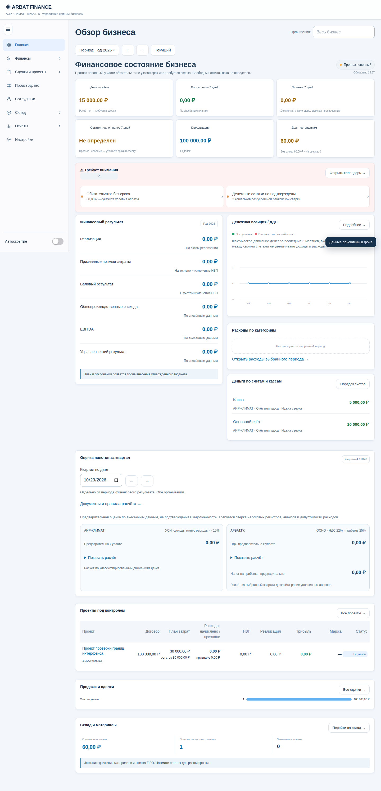

# ARBAT FINANCE: результат проверки 23 октября 2026

Исправлены воспроизведённые ошибки учёта, сохранения и интерфейса. Два замечания пользователя — одинаковые расшифровки прогноза и тяжёлая типографика — исправлены. Проверка не является обещанием отсутствия любых ошибок и не заменяет налоговую/бухгалтерскую приёмку.

## Приёмка по направлениям

| Направление | Проверено и исправлено | Результат |
|---|---|---|
| Собственник / продукт | Три карточки прогноза открывают свои суммы, сроки и документы; остаток показывает начальные деньги + поступления − платежи | Пройдены реальные переходы и возвраты на шести размерах экранов |
| Финансовый директор | ОПиУ, направления, распределение, НЗП на дату, межпериодные связи актов и начислений | Независимые контрольные примеры и текущий снимок сошлись до копейки |
| Бухгалтер | Частичная/полная оплата, стабильная связь накладной, прочие доходы и НДС, зарплатные выплаты и удержания | Исправлены пропуски и неверная классификация; налоговый блок остаётся оценочным |
| Системный аналитик | Связи приход → обязательство → оплата; выдача → расход → возврат; историческая работа → начисление; удаление с зависимостями | Пройдены отдельные регрессии и реальные формы |
| UX/UI | Обычный текст400, подписи500, заголовки/итоги600; убраны прописные заголовки; видимые расшифровки и восстановление | Computed styles и границы всех разделов проверены в браузере |
| Frontend | Формы, поисковые списки, таблицы, боковое меню, редактирование старой работы, документы без проекта | Chromium/WebKit, ширины375–2560 в совокупности сценариев |
| Backend / безопасность | Конфликты версий, новые изменения во время сохранения, отзыв сессии, роли, RLS | Серверные read-only проверки admin/accountant/отозванной сессии; изолированный employee |
| QA | Независимые ожидаемые суммы; новые тесты сначала воспроизводили ошибки; повторная интеграционная проверка | 409/409 Node, 20/20 браузерных сценариев |
| DevOps | Откат пары finance/warehouse при ошибке второй части и откат audit-событий, разрешения нового RPC, проверка опубликованного Edge-исходника | Отдельный PostgreSQL CI прошёл; миграция применена, Edge v5 ACTIVE |

## Основные исправления

1. Прогноз: отдельные строки поступлений и платежей, просроченные обязательства, исключение повторных календарных связей, объяснение неопределённого остатка, строгие даты и подтверждение кошельков. Суммы форматируются без потери копеек.
2. Типографика: единый завершающий CSS-слой переопределяет старые тяжёлые стили без изменения данных и геометрии форм.
3. Склад: обновление состояния между адаптерами, прямые списания в затратах, запрет ухудшения FIFO при удалении, сохранение связей и удалённых расходов, сбор товара с нескольких складов той же организации, очистка скрытых полей формы.
4. Производство: сохранение исторической цены/состава бригады и ID работ, открытие строки работы, корректные округления и выплаты, защита истории сотрудника, безопасная отрисовка записей без проекта.
5. Учёт: нулевая доля не получает округление, расходы не уходят в другую организацию, доход не становится расходом, будущие документы не переписывают прошлый НЗП. Расчётные переклассификации отдельно подписаны и не открывают редактирование первички.
6. Синхронизация: новые очереди не теряются, конфликты одного документа останавливают перезапись, несохранённая копия переживает перезагрузку. Связанные записи одного действия отправляются одним batch RPC с общим серверным откатом.

## Проверка действующих данных

Только чтение finance revision157 и warehouse revision40. Результат за октябрь: −1 420 368,85 ₽; АИР-КЛИМАТ −637 500,00 ₽, АРБАТ.ГК −782 868,85 ₽. ОПиУ, дашборд и независимая арифметика совпали; остаток сверки направлений0. Все три проекта рассчитаны без замечаний ядра, FIFO без предупреждений. Это не утверждение о правильности каждого исходного документа.

После серверных изменений ревизии и checksum обоих финансовых payload остались прежними. Рабочие финансовые документы не создавались, не редактировались и не удалялись.

## Браузерная приёмка: шаги

1. Главная → выбор периода → порядок кошельков → повторное открытие: успешно.
2. Три показателя прогноза → разные расшифровки → исходный документ → возврат: успешно; суммы и состав строк сверены.
3. Многострочный приход → изменение количества → сохранённая частичная оплата → смена типа операции → новый приход → перезагрузка: успешно.
4. Выдача со складов → расход3/возврат2 из выдачи5 → новый приход → перезагрузка: успешно; FIFO/затраты/ID сохранены.
5. Изменение только примечания старой работы после изменения прайса и бригады; попытка удалить сотрудника с историей: успешно; исторические значения сохранены, удаление остановлено.
6. Конфликт → копия → скачивание → перезагрузка: успешно в изолированном браузере; серверные финансовые записи не запрашиваются до решения пользователя.
7. Все разделы, открытое/закрытое меню, заполненные суммы и настройки таблиц: успешно. Проверка всех видимых настольных текстов не выявила веса выше600.

Снимки — фактические результаты финального CI, а не макеты:

## Что этой приёмкой не закрыто

- Полноценный налоговый регистр/декларации и согласование методологии по всем частным операциям. Текущая оценка налогов не является подтверждённой суммой к уплате.
- Реальная доставка писем и работа всех ролей на физических устройствах. Среди действующих enabled пользователей есть admin/accountant, действующей employee-сессии нет; employee проверен на изолированных сценариях.
- Развёртывание всей инфраструктуры с нуля по единому baseline и восстановление production из резервной копии. В существующей истории миграций есть старые одинаковые префиксы; они не переименовывались вслепую.
- Включение внешней проверки скомпрометированных паролей в настройках Supabase Auth: подключённый инструмент не предоставляет эту настройку.
- Атомарность произвольных локальных действий, разделённых во времени, и браузерного localStorage при нехватке места. Серверная атомарность относится к одной отправленной группе; ошибки локального сохранения и копии отображаются явно.

Полные доказательства и ограничения: [финансы](audit-finance-20261023.md), [склад](audit-warehouse-20261023.md), [зарплата](audit-payroll-20261023.md), [навигация](audit-navigation-20261023.md), [синхронизация](audit-security-20261023.md), [сервер](audit-server-20261023.md), [типографика](audit-typography-20261023.md).
